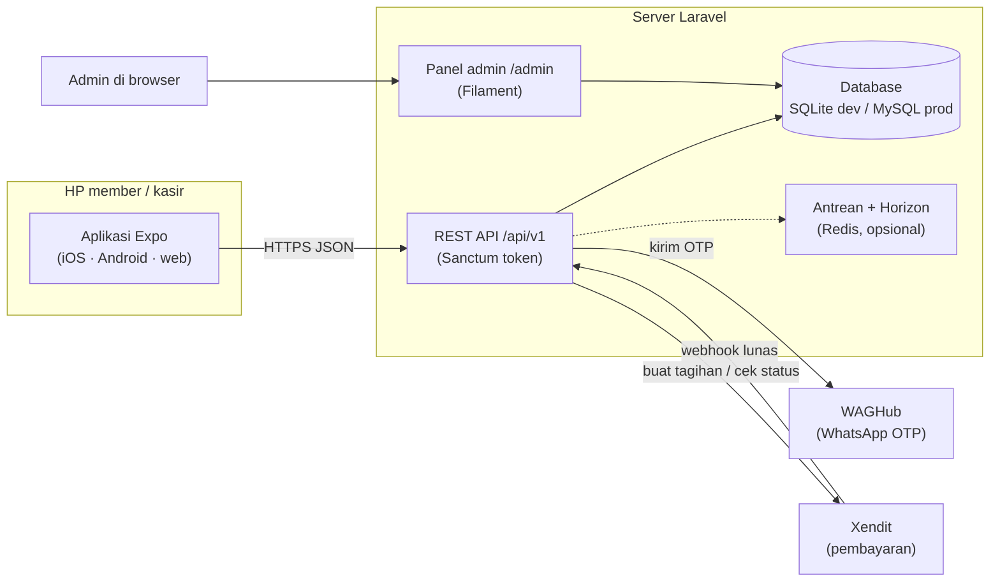
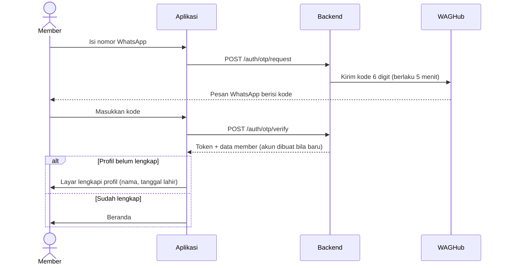
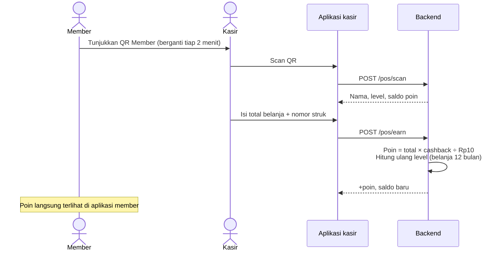
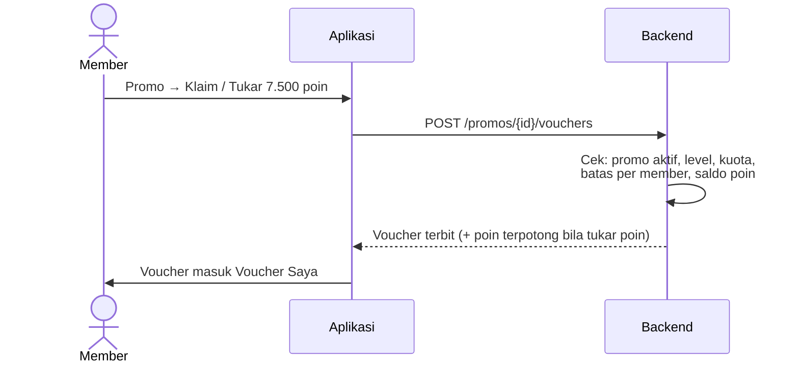
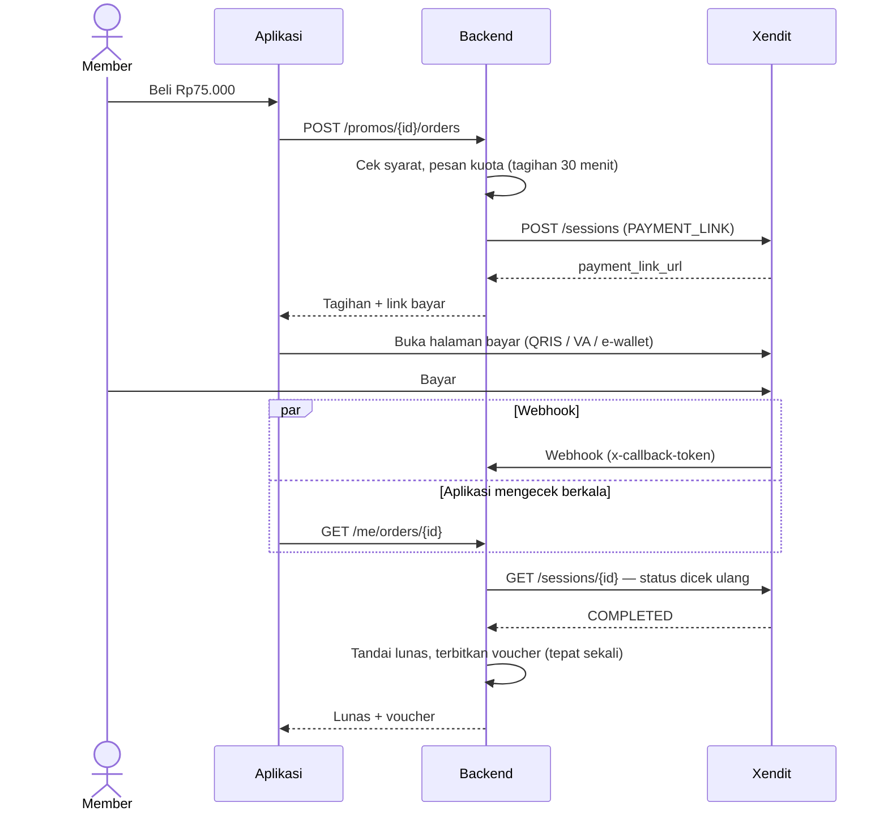
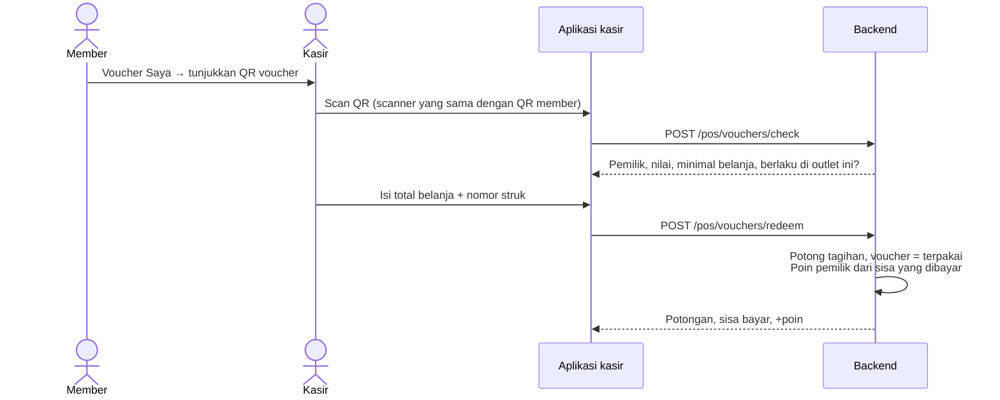
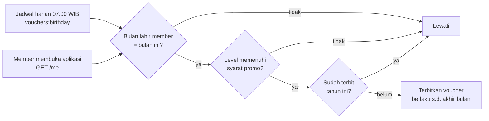
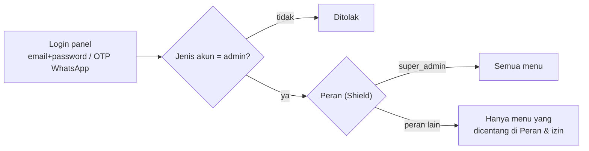

# Ocean Space — Member Club

Aplikasi member lintas brand untuk seluruh unit bisnis grup: **Ulon Signature, Ulon, Araichi Ramen, J Chicken, Luuca, Momoyo, Toko Mas An An, Complete Mulia, Padelnis, dan Grandmonde**. Satu kartu member, satu saldo poin, berlaku di semua brand.

Repositori ini berisi dua aplikasi yang memakai **satu database yang sama**:

| Folder | Isi |
|---|---|
| [`backend/`](backend) | Laravel 13 — REST API `/api/v1` untuk aplikasi + **panel admin web** (Filament) di `/admin` |
| [`mobile/`](mobile) | Expo SDK 57 (React Native) — aplikasi member untuk iPhone, Android, dan web; termasuk **Mode Kasir** |

---

## Daftar isi

1. [Fitur](#fitur)
2. [Arsitektur](#arsitektur)
3. [Teknologi](#teknologi)
4. [Struktur folder](#struktur-folder)
5. [Menjalankan di komputer](#menjalankan-di-komputer)
6. [Konfigurasi `.env`](#konfigurasi-env)
7. [Akun demo](#akun-demo)
8. [Aturan bisnis](#aturan-bisnis)
9. [Alur (flow)](#alur-flow)
10. [Panel admin](#panel-admin)
11. [API](#api)
12. [Pengujian](#pengujian)
13. [Deploy ke produksi](#deploy-ke-produksi)
14. [Keamanan](#keamanan)
15. [Roadmap](#roadmap)

---

## Fitur

### Aplikasi member (iPhone / Android / web)

- **Masuk dengan OTP WhatsApp** (lewat WAGHub), lalu lengkapi profil: nama dan tanggal lahir (untuk voucher ulang tahun).
- **Beranda**: sapaan dan saldo poin, kolom cari, 8 menu (Voucher Saya, Beli Voucher, Tukar Poin, Promo, Outlet, Brand Grup, Riwayat Poin, Level Member), carousel promo yang bergeser sendiri, katalog hadiah, outlet terdekat.
- **QR Member** bertanda tangan digital yang berganti tiap 2 menit — screenshot lama tidak bisa dipakai.
- **Poin & level**: cashback Silver 2% / Gold 5% / Platinum 8%, level naik otomatis dari belanja 12 bulan terakhir.
- **Promo & voucher**: promo info, klaim voucher gratis, tukar poin dengan voucher, **beli voucher dengan uang** (QRIS, VA, e-wallet via Xendit), voucher ulang tahun otomatis, promo khusus level tertentu.
- **Voucher Saya**: daftar voucher aktif/riwayat dan QR voucher untuk ditunjukkan ke kasir.
- **Direktori**: outlet terdekat dari GPS (jam buka, Maps, telepon, WhatsApp) dan daftar brand per kategori.
- **Profil**: foto profil (galeri/kamera), data diri, riwayat.
- Layar pembuka beranimasi, tampilan monokrom + emas dengan ikon khas berbasis logo.

### Mode Kasir (di aplikasi yang sama, untuk akun kasir/admin)

- Satu scanner untuk **QR member** (catat belanja → tambah poin, atau tukar poin) dan **QR voucher** (potong tagihan → poin dari sisa bayar).
- Idempoten per nomor struk: tekan dua kali tidak menggandakan poin/potongan.

### Panel admin web (`/admin`)

- Kelola **Brand, Outlet, Promo/Voucher, Member**, lihat **Riwayat poin, Voucher, Pembayaran voucher**.
- Aksi **Catat belanja** (struk manual) dan **Sesuaikan poin** per member.
- **Pengguna panel + Peran & izin** (Filament Shield), **Log aplikasi** (Log Viewer), **Antrean** (Laravel Horizon).
- Login dengan email + password atau OTP WhatsApp.

---

## Arsitektur



Panel dan aplikasi membaca database yang sama, jadi perubahan di panel (promo, outlet, poin) langsung terlihat di aplikasi, dan pendaftaran/transaksi dari aplikasi langsung terlihat di panel.

---

## Teknologi

| Bagian | Teknologi |
|---|---|
| Backend | PHP 8.4, Laravel 13, Sanctum (token API), PHPUnit |
| Panel admin | Filament 5 + tema Mekaya, Filament Shield (spatie/laravel-permission), Log Viewer (opcodesio), Laravel Horizon |
| Aplikasi | Expo SDK 57, React Native, Expo Router (typed routes), Reanimated, react-native-svg, expo-camera, expo-image-picker, expo-location |
| Integrasi | WAGHub (WhatsApp OTP), Xendit Payment Session (QRIS/VA/e-wallet) |
| Database | SQLite (pengembangan), MySQL/PostgreSQL (produksi) |

---

## Struktur folder

```
.
├── backend/                     # Laravel
│   ├── app/
│   │   ├── Filament/            # Panel admin: resource, halaman login, widget
│   │   ├── Http/Controllers/Api # Auth, Directory, Profile, Voucher, VoucherOrder, Pos
│   │   ├── Models/              # User, Brand, Outlet, Promo, Voucher, VoucherOrder, PointTransaction
│   │   └── Services/            # LoyaltyService, VoucherService, OtpService, MemberQr, VoucherQr,
│   │                            # Payment/XenditGateway, WhatsApp/WagHubWhatsAppSender
│   ├── config/loyalty.php       # Aturan poin, tier, OTP, WhatsApp, pembayaran
│   ├── database/                # Migrasi & seeder (data brand/outlet/promo contoh)
│   ├── public/media/            # stock/ (foto contoh Unsplash), brand/ (logo, favicon)
│   └── tests/Feature/           # 81 tes fitur
├── mobile/                      # Expo
│   ├── src/app/                 # Layar (Expo Router): (tabs)/, login, otp, cashier, vouchers, ...
│   ├── src/components/          # UI, kartu member, ikon menu, animasi pembuka, ...
│   ├── src/lib/                 # API client, sesi, hook QR, pembayaran, format
│   └── src/constants/theme.ts   # Token warna (monokrom + emas) & font
├── jalankan-backend.bat         # Klik dua kali: nyalakan API + panel (port 8010)
├── jalankan-hp.bat              # Klik dua kali: Expo untuk dicoba di HP (Expo Go)
└── jalankan-web.bat             # Klik dua kali: aplikasi versi web (port 8081)
```

---

## Menjalankan di komputer

### Prasyarat

- **PHP 8.4** dan **Composer** (di Windows paling mudah lewat [Laravel Herd](https://herd.laravel.com))
- **Node.js 20+** dan npm
- Aplikasi **Expo Go** di HP (untuk mencoba di iPhone/Android)

### 1. Backend (API + panel admin)

```bash
cd backend
composer install
cp .env.example .env          # lalu isi nilai rahasia, lihat bagian Konfigurasi .env
php artisan key:generate
touch database/database.sqlite
php artisan migrate --seed    # tabel + data contoh + izin panel + akun admin
npm install && npm run build  # membangun tema panel admin
php artisan serve --host=0.0.0.0 --port=8010
```

Di Windows cukup klik dua kali `jalankan-backend.bat` untuk menyalakan server. Port 8010 dipakai agar tidak bentrok dengan proyek lain di 8000.

- API: `http://localhost:8010/api/v1`
- Panel admin: `http://localhost:8010/admin`

### 2. Aplikasi (Expo)

```bash
cd mobile
npm install
npx expo start --lan --port 8081
```

- **Web**: buka `http://localhost:8081` (atau klik dua kali `jalankan-web.bat`).
- **HP**: klik dua kali `jalankan-hp.bat`, pasang **Expo Go**, lalu pindai QR di terminal (iPhone: pakai aplikasi Kamera). HP dan laptop harus di Wi-Fi yang sama.
  - Expo Go untuk SDK 57 di iPhone mewajibkan **login akun Expo yang sama** di HP dan di laptop (`npx expo login`).
  - Alamat API otomatis memakai IP laptop yang menjalankan Expo, jadi `mobile/.env.local` tidak perlu diubah saat ganti Wi-Fi.
- Simulator iPhone hanya ada di Mac. Di Windows bisa memakai emulator Android (Android Studio) — tekan `a` di terminal Expo.

`mobile/.env.local` (opsional):

```
EXPO_PUBLIC_API_URL=http://localhost:8010/api/v1
```

---

## Konfigurasi `.env`

Semua nilai rahasia **hanya** ada di `backend/.env` — file ini tidak ikut ke Git. Salin dari `backend/.env.example`.

| Variabel | Keterangan |
|---|---|
| `APP_NAME` | Nama aplikasi (`"Ocean Space"`) |
| `APP_URL` | URL backend, mis. `http://localhost:8010` |
| `LOYALTY_POINT_VALUE` | Nilai 1 poin dalam rupiah (default `10`) |
| `LOYALTY_QR_TTL` | Masa berlaku QR member/voucher dalam detik (default `120`) |
| `WHATSAPP_DRIVER` | `log` (OTP hanya ditulis ke log) atau `waghub` (dikirim sungguhan) |
| `WAG_URL`, `WAG_TOKEN` | Alamat dan token WAGHub |
| `WHATSAPP_DEMO_NUMBERS` | Nomor akun demo; di `APP_ENV=local` OTP-nya hanya ke log |
| `GOOGLE_CLIENT_IDS` | Client ID OAuth Google (login Google, belum dipakai aplikasi) |
| `ADMIN_EMAIL`, `ADMIN_PASSWORD` | Akun admin awal yang dibuat seeder |
| `PAYMENT_DRIVER` | `xendit` |
| `XENDIT_SECRET_KEY` | Secret key Xendit (`xnd_development_…` untuk test, `xnd_production_…` untuk live) |
| `XENDIT_CALLBACK_TOKEN` | Verification token webhook Xendit |
| `XENDIT_RETURN_URL` | Opsional, halaman HTTPS setelah bayar |
| `QUEUE_CONNECTION`, `REDIS_*` | `redis` + Redis berjalan agar Horizon aktif (produksi) |

---

## Akun demo

Dibuat oleh `php artisan migrate --seed`. Di `APP_ENV=local`, OTP untuk nomor demo **tidak dikirim ke WhatsApp** — kodenya ada di `backend/storage/logs/laravel.log`.

| Peran | Nomor WhatsApp | Catatan |
|---|---|---|
| Member | 0812 0000 0001 | Profil lengkap |
| Kasir Ulon Ciledug | 0812 0000 0002 | Profil → Mode Kasir |
| Admin (super admin) | 0812 0000 0003 | Juga bisa masuk panel dengan `ADMIN_EMAIL` + `ADMIN_PASSWORD` |

Membuat super admin baru dari server (password diketik tersembunyi):

```bash
php artisan admin:create email@perusahaan.com --name="Nama Admin" --phone=08xxxxxxxxxx
```

---

## Aturan bisnis

### Poin dan level

- **1 poin = Rp10** (100 poin = Rp1.000).
- Poin didapat dari belanja di kasir: **total belanja × cashback level ÷ Rp10**, dibulatkan ke bawah.
- Level dihitung dari **total belanja 12 bulan terakhir** dan naik otomatis.

| Level | Syarat belanja 12 bulan | Cashback | Belanja Rp100.000 | Benefit lain |
|---|---|---|---|---|
| Silver | anggota baru | 2% | 200 poin | — |
| Gold | ≥ Rp3.000.000 | 5% | 500 poin | Voucher ulang tahun |
| Platinum | ≥ Rp10.000.000 | 8% | 800 poin | Voucher ulang tahun, promo & event eksklusif |

- Tukar poin di kasir: setiap poin memotong tagihan Rp10.
- Semua aturan ada di [`backend/config/loyalty.php`](backend/config/loyalty.php).

### Jenis promo

| Jenis (di panel) | Cara member mendapatkannya |
|---|---|
| **Info** | Hanya tampil; datang ke outlet |
| **Klaim gratis** | Tombol *Klaim* → voucher masuk Voucher Saya |
| **Tukar poin** | Harga poin dan/atau harga rupiah: *Tukar … poin* atau *Beli Rp…* (Xendit) |
| **Ulang tahun** | Otomatis di bulan lahir member (sesuai syarat level), berlaku sampai akhir bulan; tidak tampil di katalog |

Promo bisa dibatasi level (mis. *khusus Platinum*), diberi kuota total, batas per member, masa berlaku setelah diambil, dan minimal belanja. Nilai voucher disalin saat terbit, jadi mengubah promo tidak mengubah voucher yang sudah dipegang member.

### Aturan di kasir

- Satu voucher untuk satu struk. Voucher hanya berlaku di brand yang ditentukan (atau semua outlet).
- Poin dihitung dari **sisa yang dibayar setelah potongan voucher**.
- Nomor struk yang sama per outlet hanya tercatat sekali (anti dobel).

---

## Alur (flow)

### 1. Daftar / masuk dengan OTP WhatsApp



Kode OTP disimpan ter-hash, maksimal 5 percobaan, kirim ulang setelah 60 detik, dan dibatasi per IP/nomor.

### 2. Kumpul poin di kasir



Tukar poin memakai alur yang sama dengan `POST /pos/redeem` (poin × Rp10 = potongan tagihan).

### 3. Klaim voucher gratis / tukar poin dengan voucher



### 4. Beli voucher dengan uang (Xendit)



Isi webhook tidak pernah dipercaya begitu saja — status lunas selalu dicek ulang ke Xendit. Member yang sudah membayar tetap mendapat voucher meski promo berakhir atau kuota penuh. Tagihan yang kedaluwarsa melepas kuotanya kembali.

### 5. Pakai voucher di kasir



### 6. Voucher ulang tahun



### 7. Akses panel admin



---

## Panel admin

Buka `http://localhost:8010/admin`. Hanya akun berjenis **admin** yang bisa masuk; menu yang terlihat bergantung pada perannya.

| Menu | Isi |
|---|---|
| Dasbor | Jumlah member, belanja & poin bulan ini, promo tayang, transaksi terbaru (diperbarui tiap 30 detik) |
| Katalog → Brand / Outlet / Promo | Data brand, outlet (jam buka, koordinat, foto 4:3), promo & voucher (jenis, nilai, harga poin/rupiah, kuota, level) |
| Member & poin → Member | Data member & kasir, **Catat belanja**, **Sesuaikan poin** |
| Member & poin → Riwayat poin | Semua transaksi poin (hanya-baca) |
| Member & poin → Voucher | Voucher terbit/terpakai per outlet + total potongan (rekonsiliasi antar-entitas) |
| Member & poin → Pembayaran voucher | Tagihan Xendit, status, total, tombol **Cek status** |
| Akses & sistem → Pengguna panel | Akun admin + perannya, *Jadikan admin dari member*, *Cabut akses* |
| Akses & sistem → Peran & izin | Buat peran dan centang izinnya per menu, widget, dan izin khusus |
| Akses & sistem → Log aplikasi / Antrean (Horizon) | Log Viewer dan dasbor Horizon |

Izin khusus: *Kelola pengguna panel*, *Sesuaikan poin member*, *Catat belanja manual*, *Buka log aplikasi*, *Buka Laravel Horizon*.

Setelah menambah resource/widget baru di panel, perbarui daftar izinnya:

```bash
php artisan shield:generate --all --panel=admin --option=permissions
```

---

## API

Semua endpoint di bawah prefix `/api/v1`. Endpoint member memakai token Sanctum dari login OTP (`Authorization: Bearer …`).

| Method | Endpoint | Akses |
|---|---|---|
| POST | `/auth/otp/request`, `/auth/otp/verify`, `/auth/google` | Publik (dibatasi) |
| GET | `/brands`, `/outlets?lat&lng&category&brand_id&q`, `/outlets/{id}`, `/promos?category&brand_id`, `/tiers` | Publik |
| GET/PATCH | `/me` · GET `/me/qr` · GET `/me/points` · POST `/auth/logout` | Member |
| POST/DELETE | `/me/avatar` (multipart `file`, maks 5 MB) | Member |
| GET | `/me/vouchers?status=active\|history`, `/me/vouchers/{id}`, `/me/vouchers/{id}/qr` | Member |
| POST | `/promos/{id}/vouchers` (klaim gratis / tukar poin) | Member |
| POST · GET | `/promos/{id}/orders` (beli dengan uang) · `/me/orders/{id}` (status) | Member |
| POST | `/pos/scan`, `/pos/earn`, `/pos/redeem`, `/pos/vouchers/check`, `/pos/vouchers/redeem` | Kasir/admin |
| POST | `/admin/brands/{id}/logo`, `/admin/outlets/{id}/photo`, `/admin/promos/{id}/image` | Admin |
| POST | `/payments/xendit/webhook` (header `x-callback-token`) | Xendit |

Endpoint `/pos/*` yang sama nantinya bisa dipanggil langsung oleh sistem POS tiap brand.

---

## Pengujian

```bash
cd backend && php artisan test
```

```bash
cd mobile && npx tsc --noEmit && npx expo lint
```

Tes backend (81 tes) mencakup login OTP & WAGHub, poin & level, kasir (idempoten per struk), QR bertanda tangan, voucher (klaim, tukar poin, ulang tahun, kuota, level, pemakaian di kasir), pembayaran Xendit (respons dipalsukan — tidak ada request keluar), panel admin, serta peran & izin.

---

## Deploy ke produksi

- [ ] Database MySQL/PostgreSQL, `APP_ENV=production`, `APP_DEBUG=false`, HTTPS
- [ ] `WHATSAPP_DRIVER=waghub` dengan token WAGHub produksi
- [ ] Xendit: aktivasi akun (verifikasi bisnis), key **Live**, daftarkan webhook `https://DOMAIN/api/v1/payments/xendit/webhook` untuk event Payment Session, isi `XENDIT_CALLBACK_TOKEN`
- [ ] Scheduler Laravel (voucher ulang tahun harian): cron `* * * * * php artisan schedule:run`
- [ ] Redis + `QUEUE_CONNECTION=redis` + `php artisan horizon` lewat Supervisor (butuh ekstensi `pcntl`, Linux)
- [ ] `php artisan migrate --force`, `php artisan shield:generate --all --panel=admin --option=permissions`, `npm run build`, `php artisan optimize`
- [ ] Ganti foto contoh dengan foto outlet & promo asli; isi alamat, koordinat, telepon, jam buka outlet
- [ ] Build aplikasi (ikon & nama "Ocean Space" di HP) dengan EAS: `npx eas-cli@latest build`

---

## Keamanan

- Rahasia (token WAGHub, key Xendit, password admin, `APP_KEY`) hanya di `backend/.env`, tidak pernah di repositori.
- QR member dan QR voucher ditandatangani HMAC dan berlaku 2 menit.
- OTP di-hash, dibatasi percobaan dan frekuensinya; nomor non-admin tidak menerima OTP panel.
- Webhook pembayaran diverifikasi token dan status selalu dicek ulang ke Xendit.
- Panel memakai peran & izin (Shield); akun tidak bisa mengubah perannya sendiri, dan hanya super admin yang bisa memberi peran super admin.
- Transaksi poin dan voucher idempoten per nomor struk.

---

## Roadmap

- [x] Fase 1 — member, QR, poin di kasir, katalog promo, direktori outlet, panel admin
- [x] Fase 2 — level member, voucher (klaim, tukar poin, ulang tahun, beli dengan uang via Xendit)
- [ ] Pembagian uang pembelian voucher ke tiap PT/CV (Xendit xenPlatform: sub-account + split rule) — menunggu aturan finance
- [ ] Login Google di aplikasi (backend sudah siap, butuh Client ID & development build)
- [ ] Fase 3 — integrasi langsung POS kasir tiap brand, notifikasi push promo berbasis lokasi (geo-fencing)

---

Foto contoh di `backend/public/media/stock` berasal dari Unsplash (Unsplash License) — daftar fotografer ada di [`CREDITS.md`](backend/public/media/stock/CREDITS.md). Ganti dengan foto milik brand sebelum rilis.
